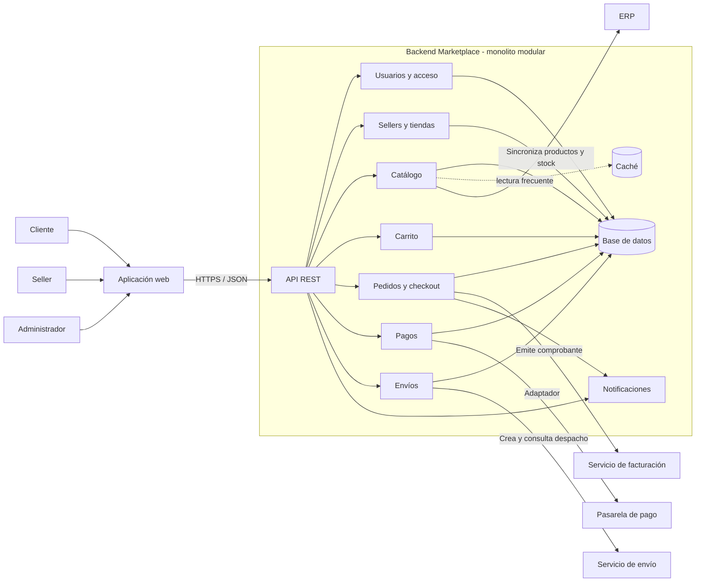

# Componentes arquitectónicos

## Vista de componentes del backend

El diagrama presenta la arquitectura objetivo del Marketplace como monolito modular. Los módulos se ejecutan dentro de una API REST y comparten el almacenamiento transaccional. Las integraciones externas se aíslan mediante adaptadores. Esta vista amplía el contexto inicial de [`arquitectura-inicial.md`](arquitectura-inicial.md).

## Responsabilidades y relaciones

| Componente | Responsabilidad | Colabora con |
|---|---|---|
| API REST | Validar la entrada, autenticar y autorizar solicitudes, y dirigirlas al módulo correspondiente | Todos los módulos |
| Usuarios y acceso | Cuentas, sesión y permisos por rol | Sellers, Pedidos, API |
| Sellers y tiendas | Perfil del vendedor y gestión de su oferta | Catálogo, Usuarios |
| Catálogo | Productos, categorías, precio publicado y stock consultable | ERP, caché, Sellers |
| Carrito | Selección temporal de productos y cálculo del total | Catálogo, Pedidos |
| Pedidos y checkout | Coordinar validación, cobro, persistencia y estado del pedido | Carrito, Pagos, Envíos, Facturación, Notificaciones |
| Pagos | Traducir el contrato de cobro al protocolo del proveedor | Pasarela de pago, Pedidos |
| Envíos | Crear y consultar despachos | Servicio de envío, Pedidos |
| Notificaciones | Informar al cliente cambios del pedido | Pedidos |
| Base de datos | Persistir cuentas, tiendas, catálogo y pedidos | Módulos de negocio |
| Caché | Reducir lecturas repetidas del catálogo | Catálogo |

## Flujo de compra

1. El cliente consulta el Catálogo y agrega productos al Carrito.
2. La API recibe la confirmación y el módulo Pedidos valida el carrito y el stock.
3. Pedidos solicita el cobro al módulo Pagos, que usa el adaptador de la pasarela.
4. Solo con cobro aprobado se confirma y persiste el pedido.
5. Pedidos solicita la emisión del comprobante y la creación del despacho; Notificaciones informa el resultado.

Los pasos 4 y 5 requieren política de compensación y reintentos para fallos parciales. Esta decisión se mantiene como pendiente de diseño antes de integrar proveedores reales.

## Correspondencia con el prototipo

El ejemplo ejecutable de [`../../tecnologia/clean-architecture/`](../../tecnologia/clean-architecture/) demuestra catálogo, carrito, pedido, pago y notificación mediante contratos y adaptadores en memoria o simulados. No implementa todavía el backend desplegable, la API REST ni los componentes de ERP, caché, envío y facturación mostrados en la arquitectura objetivo.
