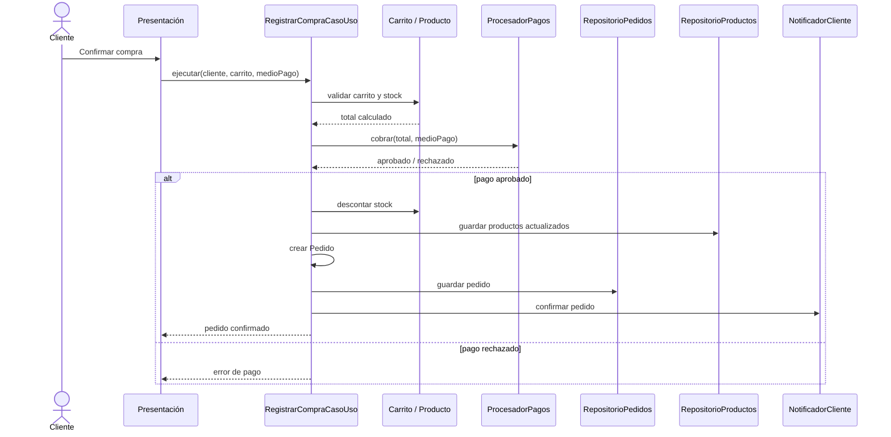
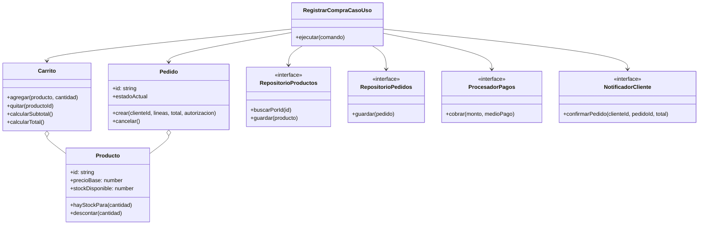

# Diseño interno de módulos

## Alcance

Este diseño detalla las colaboraciones internas del flujo de compra para el monolito modular propuesto. Los contratos de dominio y los casos de uso del prototipo Clean Architecture en `tecnologia/clean-architecture/src/app/` sirven como ejemplo ejecutable, no como implementación completa de la API objetivo.

## Módulos y contratos

| Módulo | Elementos internos | Contrato que expone |
|---|---|---|
| Catálogo | Producto, filtro de catálogo, consulta de productos | `RepositorioProductos` |
| Carrito | Carrito, línea de carrito, reglas de stock y total | Comandos de agregar/quitar y consulta de total |
| Pedidos | Pedido, estado de pedido, caso de uso de compra | `RepositorioPedidos` |
| Pagos | Resultado de cobro y adaptador de proveedor | `ProcesadorPagos` |
| Notificaciones | Mensaje de confirmación y adaptador de canal | `NotificadorCliente` |

## Secuencia interna: confirmar compra

## Clases principales del prototipo

## Reglas y límites

- Las entidades `Producto`, `Carrito` y `Pedido` validan invariantes del negocio sin depender de Angular o de una base de datos.
- `RegistrarCompraCasoUso` coordina el flujo y depende de interfaces; infraestructura provee adaptadores concretos.
- La composición de adaptadores queda en `app.config.ts` del prototipo.
- El prototipo descuenta stock después de recibir aprobación de pago. La consistencia entre pago externo y persistencia requiere idempotencia y compensación en el backend objetivo.
- Los datos de tarjeta no deben persistirse ni incluirse en logs; el prototipo usa un medio de pago simulado y no procesa datos productivos.
