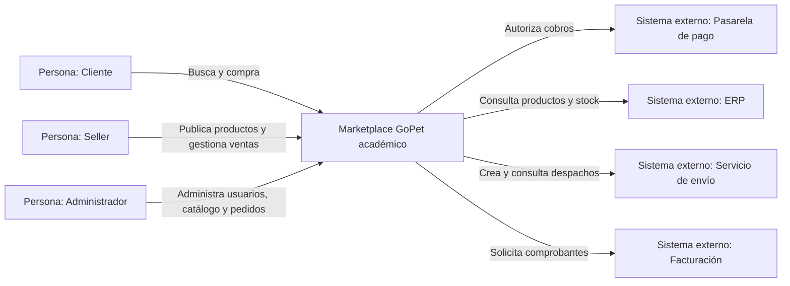
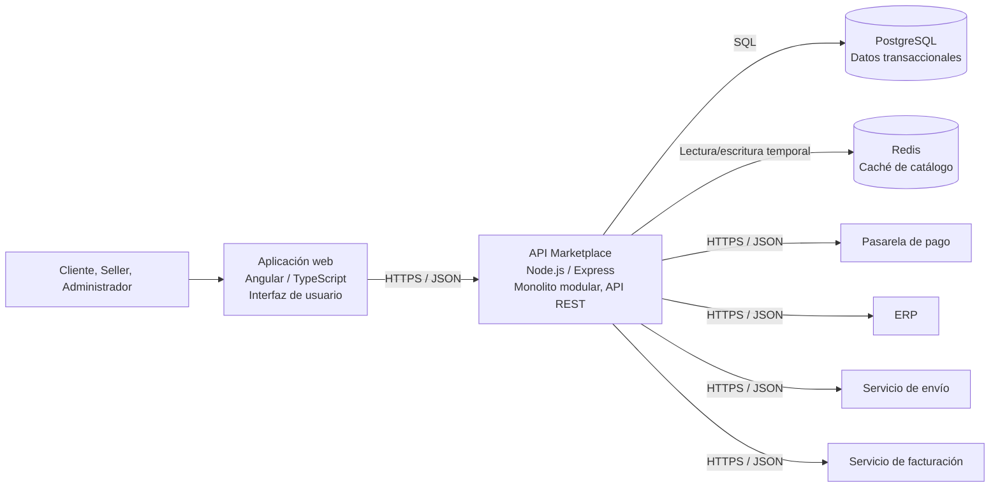
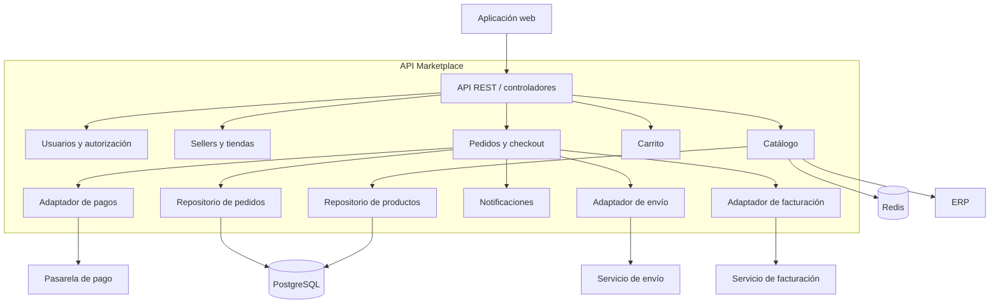

# Modelo C4 del Marketplace

El modelo C4 documenta el sistema objetivo desde el contexto hasta los componentes. Cada diagrama se mantiene como Mermaid para que pueda revisarse y versionarse junto al texto. Los nombres de contenedores y tecnologías describen la arquitectura propuesta; el prototipo académico actual demuestra solo parte de ellos.

## C1. Contexto del sistema

El Marketplace es el límite del sistema. Los actores lo usan por una aplicación web; los cuatro servicios son dependencias externas y se comunican mediante adaptadores.

## C2. Contenedores

La aplicación web presenta el sistema y la API concentra los módulos de negocio en un único despliegue. PostgreSQL es el almacén transaccional propuesto y Redis es una optimización de lectura, no una fuente de verdad. La selección tecnológica es una propuesta arquitectónica y no describe infraestructura ya desplegada.

## C3. Componentes de la API

Los componentes y responsabilidades se describen con más detalle en [`../02-arquitectura/componentes-arquitectonicos.md`](../02-arquitectura/componentes-arquitectonicos.md). El diagrama C3 resume los límites internos de la API.

## C4. Código

El nivel de código detalla clases, interfaces y métodos; se documenta en [`../03-diseño-de-software/diseño-interno/diseño-interno-de-modulos.md`](../03-diseño-de-software/diseño-interno/diseño-interno-de-modulos.md). El prototipo de Clean Architecture provee ejemplos verificables de entidades, casos de uso, contratos y adaptadores. Para componentes aún no implementados, el C4 de código se completará cuando existan módulos y contratos concretos.

## Trazabilidad

| Elemento C4 | Requisitos / drivers relacionados |
|---|---|
| Cliente, Seller, Administrador | Actores y casos de uso de catálogo, compra y administración |
| API REST | RC03 y DA05 |
| Catálogo y caché | AC01, AC03, DA01 y DA02 |
| Usuarios y autorización | AC04 y DA03 |
| Pedidos y pagos | Historias de carrito/compra, RC04 y DA04 |
| Adaptadores ERP, envío y facturación | RC05, RC06, RC07, DA08 y DA09 |
| Monolito modular y módulos | AC05, DA06, ADR-001 y ADR-002 |
